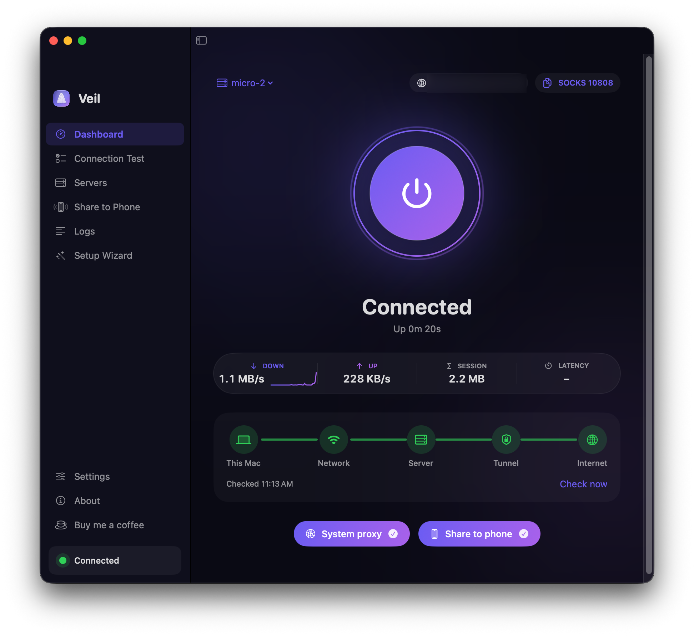
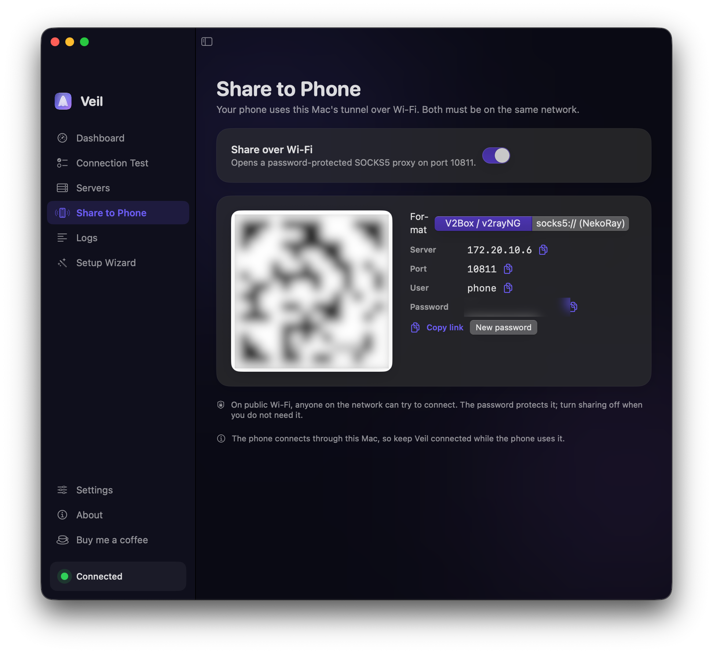

# Veil

**A fast, private connection to your own server, for your Mac and your phone.**

Veil connects your Mac to a small server you own, on networks where ordinary VPNs keep stalling. A step-by-step setup
gets you from "I have a server" to a working connection in a few minutes. You don't need to know anything about
networking.

  
  

## Download

**[Download the latest version](https://github.com/g3ntrix/veil/releases/latest)** (the `.dmg` file).

Works on macOS 13 or newer, on Apple silicon and Intel Macs.

## Install

1. Open the downloaded `.dmg` and drag **Veil** into **Applications**.
2. Open Veil.
3. If macOS says it can't open Veil, go to **System Settings → Privacy & Security**, scroll down to the message about
   Veil and click **Open Anyway**.

Veil isn't notarized by Apple (that needs a paid developer account), so macOS asks you to confirm the first time.

## What you need

- A small Linux server (VPS) with **Ubuntu or Debian**. The cheapest plan is enough. Oracle Cloud has a free tier;
  Hetzner, DigitalOcean and Vultr cost a few dollars a month.
- A way to log in to it (the provider shows you how when you create it).

## How to use it

1. Open Veil and follow the setup. It asks for your server's IP address.
2. Copy the one command Veil shows you and paste it into your server's terminal. Veil watches and moves on by itself
   when it's done.
3. If your provider has its own firewall (like Oracle Cloud), Veil shows you which rule to add.
4. Veil tests the connection, and you're done. Press the big button to connect or disconnect any time.

**Use it for your whole Mac:** turn on **System proxy**.
**Use it on your phone:** turn on **Share to phone** and scan the QR code with V2Box, v2rayNG or NekoRay. Your phone
and Mac must be on the same Wi-Fi.

## Privacy

No ads, no accounts, no tracking. Your passwords and keys are created on your Mac and kept in your Keychain. Veil only
talks to your own server, and to GitHub to check for updates.

## Buy me a coffee

If Veil is useful to you, you can support it from the **Buy me a coffee** page in the app, or here:

- USDT (BEP20): `0x71F41696c60C4693305e67eE3Baa650a4E3dA796`
- TON: `UQCriHkMUa6h9oN059tyC23T13OsQhGGM3hUS2S4IYRBZgvx`
- TRX (TRON): `TFrCzU7bDey9WSh3fhqCBqhaiMzr8VhcUV`

## License

Free and open source under the [GPL-3.0](LICENSE). Made by [g3ntrix](https://github.com/g3ntrix).
Includes [Xray-core](https://github.com/XTLS/Xray-core) (MPL-2.0).
